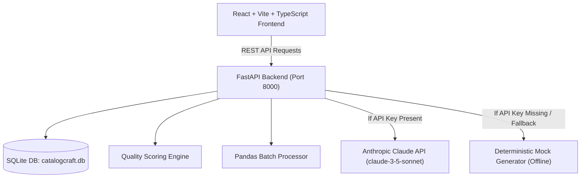

# CatalogCraft AI — Retail Product Description Generator

> **TCS Technology Day Prototype**  
> *“Generate compelling, consistent, SEO-ready retail product content at scale.”*

---

## 📌 Executive Overview & Business Problem

Retailers frequently manage massive product catalogues spanning thousands of SKUs across multiple categories. Manually writing high-converting, accurate, and SEO-optimized product descriptions is:
- **Slow & Expensive:** Takes hours of copywriter time per batch.
- **Inconsistent:** Varies widely across teams, categories, and vendors.
- **Hallucination Prone:** Basic AI tools invent unverified specs, materials, and warranties.
- **Hard to Scale:** Difficult to maintain consistent brand voice and search keywords.

**CatalogCraft AI** solves this by accepting structured product specifications (JSON/CSV or form input) and leveraging controlled AI prompts to generate high-quality e-commerce descriptions with built-in quality scoring, brand compliance checks, batch processing, and human-in-the-loop review workflows.

---

## 🚀 Key Features

1. **Single Product Description Generator (`/generate`):**
   - Rich form for structured product details (Name, SKU, Brand, Category, Price, Features list, Specs key-value pairs, Target Audience, USP, Material, Dimensions, Color, Weight, SEO keywords).
   - Generates: Title, Short Description (40–60 w), Full Description (80–120 w / 150–200 w), Bullet Highlights, Meta Title, Meta Description, Suggested Keywords, Missing-Data Warnings.
   - Quality Score Breakdown Panel (Completeness, SEO, Readability, Brand Voice Alignment).
   - Inline Editing, Version History Tracking, Copy buttons, and Download options (TXT/JSON).

2. **Batch Generator (`/batch`):**
   - Drag-and-drop CSV & JSON file processing powered by Python Pandas.
   - Pre-validation of rows with line-by-line error reports.
   - Shared generation options (Tone, Word Count, Language).
   - Real-time progress tracking bar with failure-isolation (processing continues even if 1 row fails).
   - One-click retry for failed items and CSV/JSON export.

3. **Product Catalogue & Review Workflow (`/catalogue`, `/catalogue/:id`):**
   - Search by product name, SKU, brand, and category.
   - Multi-filtering by Category, Brand, Tone, Content Status (Draft, Approved, Needs Review), and Quality Score ranges.
   - Side-by-side Review View: Original structured inputs on left vs AI Output on right.
   - Approval workflow and "Human Edited" badge tracking.

4. **Executive Dashboard & Advanced Analytics (`/`, `/analytics`):**
   - Real-time metrics: Total Products, Generated Count, Approved Count, Avg SEO Score, Avg Quality Score.
   - Interactive Recharts: Generation volume over time, Category distribution, Quality Score buckets, Tone usage distribution, Content status overview.
   - Detailed explanatory notes beneath each chart for Tech Day presentation judges.

5. **Brand Voice & Content Rules (`/settings`):**
   - Configurable Brand Name, Voice description, Preferred words, Prohibited words, Mandatory legal disclaimer, Keyword limits, and Bullet policies.
   - Live AI System Prompt Preview & Output Example preview.

6. **Responsible AI Framework (`/responsible-ai`):**
   - Mandatory human-in-the-loop review policy.
   - Zero hallucination guardrails (strict schema grounding).
   - Zero PII / Customer Data privacy policy.

7. **Automatic AI Dual Mode (Claude API + Deterministic Mock Fallback):**
   - Uses Anthropic Python SDK (`claude-3-5-sonnet-20241022`) when `ANTHROPIC_API_KEY` is set.
   - Automatically switches to `MockGenerator` offline mode when key is absent or API fails.

---

## 🛠️ Technology Stack

### Backend
- **Python 3.12+** / **FastAPI** / **Uvicorn**
- **Pydantic v2** & **Pydantic Settings**
- **SQLAlchemy ORM** & **SQLite Database** (`catalogcraft.db`)
- **Pandas** for CSV/JSON batch processing
- **Anthropic Python SDK** (`anthropic`)
- **Pytest** for backend unit test suite

### Frontend
- **React 18** + **Vite** + **TypeScript**
- **Tailwind CSS** (Custom Design Tokens, Enterprise Theme, Dark Mode Toggle)
- **Lucide React Icons**
- **Recharts** for analytics charts
- **React Router DOM v6**
- **Axios API Client**

---

## 🏗️ Architecture Diagram



---

## 📁 Repository Structure

```
catalogcraft-ai/
├── README.md
├── .gitignore
├── backend/
│   ├── .env.example
│   ├── requirements.txt
│   ├── app/
│   │   ├── main.py
│   │   ├── config.py
│   │   ├── database.py
│   │   ├── models/
│   │   │   ├── product.py
│   │   │   ├── generated_content.py
│   │   │   ├── brand_settings.py
│   │   │   ├── batch_job.py
│   │   │   └── content_version.py
│   │   ├── schemas/
│   │   ├── routers/
│   │   │   ├── health.py
│   │   │   ├── products.py
│   │   │   ├── generation.py
│   │   │   ├── batch.py
│   │   │   ├── settings.py
│   │   │   ├── analytics.py
│   │   │   └── export.py
│   │   ├── services/
│   │   │   ├── ai/ (base, prompt_builder, response_parser, mock_generator, claude_service)
│   │   │   ├── scoring/ (quality_scorer)
│   │   │   ├── batch/ (batch_processor)
│   │   │   └── export/ (exporter)
│   │   ├── seed/ (seed_data - 50+ sample products across 8 categories)
│   │   └── tests/ (test_backend.py)
│   ├── data/ (sample_products.csv, sample_products.json)
│   ├── uploads/
│   └── exports/
└── frontend/
    ├── .env.example
    ├── package.json
    ├── vite.config.ts
    ├── tailwind.config.js
    └── src/
        ├── main.tsx
        ├── App.tsx
        ├── api/ (client.ts, services.ts)
        ├── components/ (Navbar, Sidebar, QualityScoreBadge, QualityScorePanel, CopyButton, Toast, LoadingSkeleton)
        ├── pages/ (Dashboard, GenerateDescription, BatchGenerator, ProductCatalogue, ProductReview, Analytics, BrandSettings, ResponsibleAI, HelpDocs, NotFound)
        ├── layouts/ (RootLayout.tsx)
        ├── styles/ (index.css)
        └── types/ (index.ts)
```

---

## ⚙️ Setup & Installation Instructions

### Prerequisites
- Python 3.11+
- Node.js v18+ & npm

### 1. Backend Setup

```bash
# Navigate to backend directory
cd backend

# Create Python virtual environment
python -m venv .venv

# Activate virtual environment
# Windows:
.\.venv\Scripts\activate
# macOS/Linux:
source .venv/bin/activate

# Install requirements
pip install -r requirements.txt

# Configure environment (Optional: add ANTHROPIC_API_KEY)
cp .env.example .env

# Run FastAPI server (Port 8000)
uvicorn app.main:app --reload --port 8000
```

The backend server automatically initializes `catalogcraft.db` and seeds **50+ realistic retail products across 8 categories** (Electronics, Fashion, Home and Kitchen, Beauty & Personal Care, Sports & Fitness, Grocery, Furniture, Travel Accessories) on first boot.

### 2. Frontend Setup

```bash
# Navigate to frontend directory
cd frontend

# Install npm dependencies
npm install

# Run Vite dev server (Port 5173)
npm run dev
```

Open `http://localhost:5173` in your browser.

---

## 🧪 Running Unit Tests

To run the backend test suite:

```bash
cd backend
.\.venv\Scripts\python -m pytest app/tests
```

All 9 backend test cases cover:
- Health endpoint response.
- Product Pydantic schema validation.
- Brand settings schema validation.
- Prompt builder string formatting.
- Mock generator deterministic generation.
- Quality score math & recommendations.
- CSV/JSON row normalization.
- Product CRUD endpoints.
- CSV & JSON export endpoints.

---

## 📋 TCS Tech Day Demonstration Workflow

1. **Dashboard Overview (`/`):**
   - Point out the 7 key metric cards populated with seed data.
   - Showcase the 5 interactive Recharts visualization panels.

2. **Single Product Copy Generator (`/generate`):**
   - Click **"Load Sample Product"** to auto-fill specs for the *AeroNoise Pro Headphones*.
   - Click **"Generate Description"**.
   - Review the generated output, copy fields, download TXT/JSON, and review the **Quality Score Breakdown Panel**.
   - Click **"Edit Content"** to modify text and watch the quality score recalculate instantly.

3. **Batch Generation (`/batch`):**
   - Click **"Download Sample CSV"** (contains 50 products across 8 categories).
   - Drag and drop `sample_products.csv` into the dropzone.
   - Choose tone (e.g. *Premium / Luxury*) and click **"Start Batch Generation"**.
   - Watch real-time progress and export completed results to CSV or JSON.

4. **Product Catalogue & Side-by-Side Review (`/catalogue`):**
   - Search products, filter by Category or Quality Score.
   - Click **"Review"** on any item to open the side-by-side comparison view with version history logs.

5. **Brand Rules Customization (`/settings`):**
   - Add prohibited words (e.g., "cheap", "fake") and click **"Save Brand Settings"**.
   - View the live updated System Prompt in the right-hand panel.

---

## 🛡️ Responsible AI Statement

CatalogCraft AI enforces strict schema constraints so AI models never hallucinate technical specifications, prices, or materials. Human review is enforced prior to publishing to production channels.

---

## 📄 License & Attribution

Built for TCS Technology Day 2026. All rights reserved.
